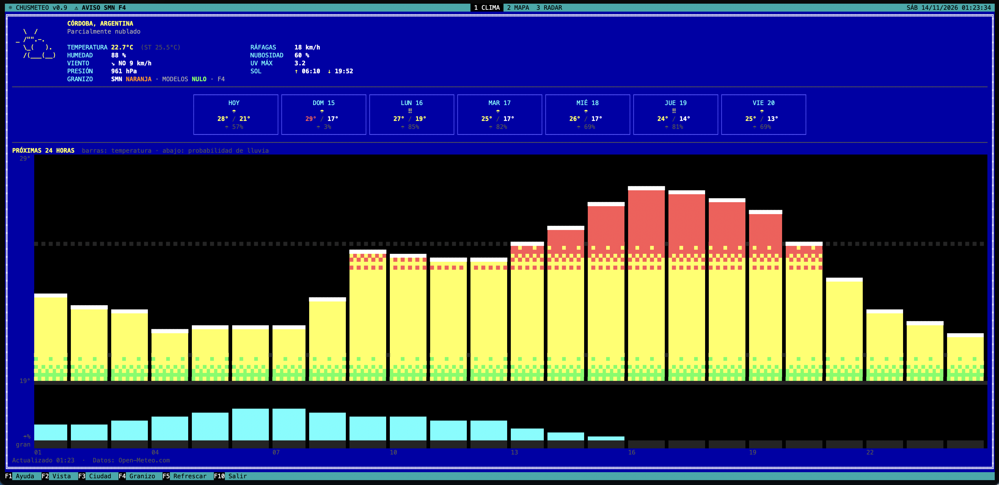
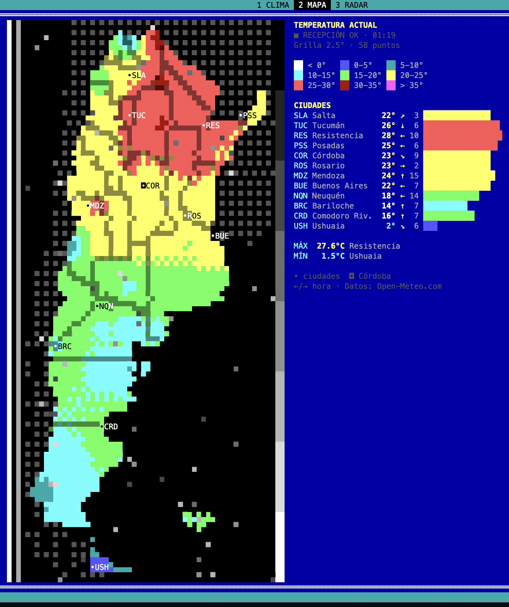
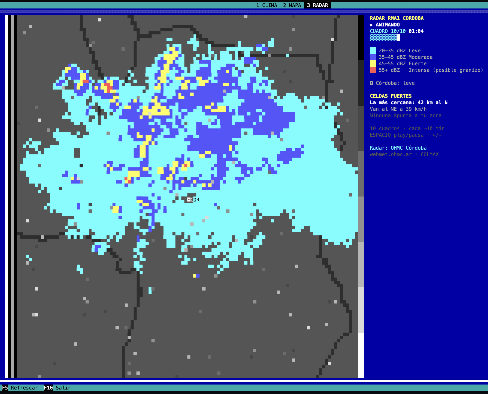
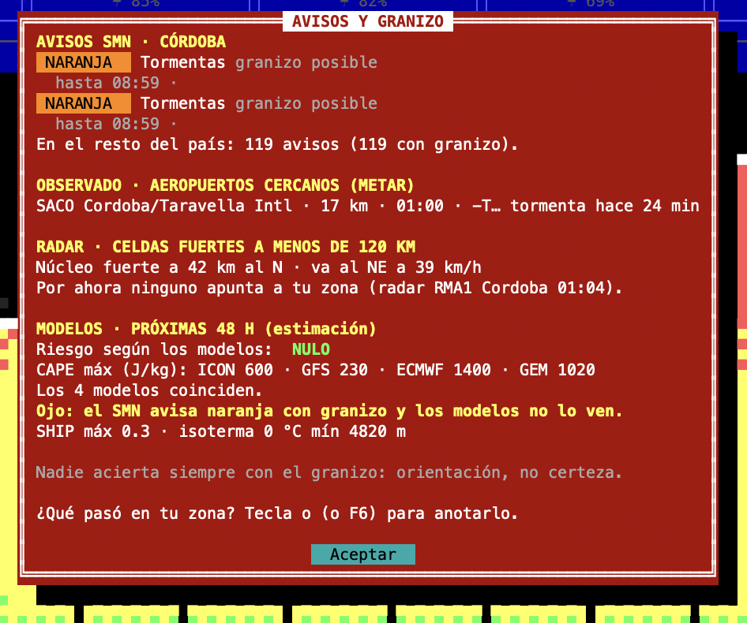
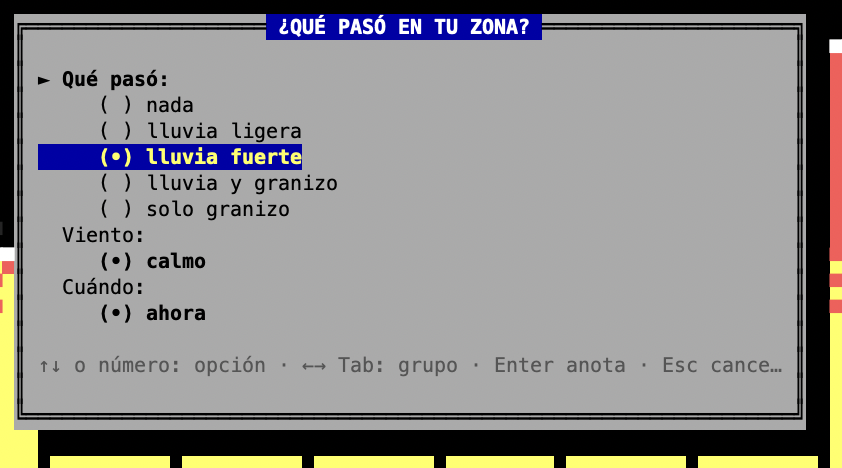

# chusmeteo ☼

El clima en tu terminal, con estética de DOS de los 90.
Hobby + excusa para aprender Go.



> **In English.** chusmeteo is a weather app for Argentina that runs in your terminal and
> looks like a 90s DOS program: 16 VGA colours, box-drawing dialogs and maps drawn with
> half-block "pixels". It shows current conditions and a 7-day forecast, a temperature map
> of the country, and animated weather radar. It is a hobby project written in Go with
> [Bubble Tea](https://github.com/charmbracelet/bubbletea), and the code is commented as a
> Go tutorial for people coming from Java.
>
> Its main focus is **hail**. It tracks strong radar cells from Argentina's national radar
> network and estimates when they will reach you, follows the short-term warnings of the
> national weather service (SMN), and compares four global models plus an 80-member
> ensemble for the next 48 hours. Data comes from Open-Meteo, SMN, the Córdoba
> Hydro-Meteorological Observatory (OHMC), NOAA's Aviation Weather Center and Rain Viewer;
> no API keys are needed. The interface and the rest of this README are in Spanish.
> Run it with `go run ./cmd/chusmeteo -city "Córdoba"`.

| Mapa de temperaturas | Radar (RMA1 Córdoba, dBZ reales) |
|---|---|
|  |  |

| Avisos y granizo (F4) | ¿Qué pasó en tu zona? (F6) |
|---|---|
|  |  |

Todo es *responsive*: el panel ocupa la terminal entera y cada vista usa el
espacio que tenga. Cuanto más grande la ventana, más detalle en pixel art.

Tres vistas:

1. **Clima**: condiciones actuales, pronóstico de hasta 7 días y, si hay alto, un gráfico de las próximas 24 horas.
2. **Mapa**: Argentina coloreada por temperatura, con 12 ciudades de referencia y la dirección del viento en cada una (`↗`). Con `←` `→` se navega el pronóstico hora a hora (hasta +23 h).
3. **Radar**: precipitación animada. Con un radar argentino cerca, zoom a tu región con reflectividad real (dBZ); si no, el país entero con Rain Viewer.

Y con **F4**, un popup al estilo de los diálogos de Norton Commander con todo lo
que hay sobre **granizo**: los avisos vigentes del SMN para tu ciudad (y cuántos hay
en el resto del país, con los de **corto plazo** primero), las **celdas fuertes** que el
radar ve a menos de 120 km y si alguna viene hacia vos, y el riesgo de las próximas 48 h
según cuatro modelos (ICON, GFS, ECMWF, GEM) y un ensamble de 80 corridas.
Cada tramo de riesgo indica el día ("hoy 15–18 h", "mañana 14 h"). También
muestra lo **observado** en los aeropuertos cercanos (METAR, hasta ~200 km): tormenta (`TS`) y
granizo (`GR`) reportados en las últimas 3 h. Si una estación a menos de 100 km reporta
granizo en los últimos 90 min, la barra superior avisa igual. Si hay
algo urgente para tu punto, la barra superior **titila**: `⚠ CELDA EN 35 MIN` (radar),
`⚠ AVISO A CORTO PLAZO` (SMN) o `⚠ GRANIZO OBSERVADO CERCA` (aeropuerto). La alerta por
zona del SMN y el riesgo de los modelos quedan fijos, sin titilar (`⚠ AVISO SMN`,
`⚠ GRANIZO?`): son el contexto del día, y las alertas por zona nombran el granizo siempre.
Si viene un núcleo intenso pero la isoterma de 0 °C está por encima de 4600 m, el popup
dice "lluvia muy intensa; granizo poco probable".

Las vistas de mapa "se reciben" como en una PC de los 90 conectada a una antena:
la imagen baja línea por línea, con estática, franjas de sincronismo a la izquierda,
cuña de grises de telemetría a la derecha y corrimiento Doppler en la frecuencia.
Es un homenaje al APT de los satélites NOAA: NOAA-15, el último que lo transmitía,
se apagó el 19/08/2025.

```
 ☼ CHUSMETEO v0.4         1 CLIMA  2 MAPA  3 RADAR        SÁB 24/10/2026 00:12:00
     ╔════════════════════════════════════════════════════════════════════╗
     ║ ▌▐ ▄▄███▄          ▓  TEMPERATURA ACTUAL                           ║
     ║ ▌▐ ███████▄ ▄█     ▓  ◄ RECIBIENDO NOAA-15                         ║
     ║ ▌▐ ████◘█████      ▓  137.6197 MHz ▮▮▮▮▮▮▮▯                        ║
     ║ ▌▐ ▓▒░▒▓░▒░▓▒      ▒                                               ║
     ║ ▌▐ ░ ▒  ░ ▒ ░      ░  SLA  31°  TUC  29°  RES  28° ...             ║
```
*(en la terminal es a color: correlo y mirá)*

## Arrancar

```bash
brew install go              # si no lo tenés (Go 1.24+)
go mod tidy                  # la primera vez
go run ./cmd/chusmeteo
go run ./cmd/chusmeteo -city "Mendoza" -view mapa
go run ./cmd/chusmeteo -view radar -nofx    # sin efecto de recepción
go run ./cmd/chusmeteo -hardcore            # agrega la vista SAT (RTL-SDR)
go run ./cmd/chusmeteo -gps                 # usa la ubicación de tu Mac
```

**Ubicación (macOS).** `-gps` (o la tecla `g`) ubica la compu con CoreLocation. Las Mac no tienen GPS: estima con Wi-Fi, así que tenelo prendido. Requiere `brew install --cask corelocationcli` y darle permiso de localización a tu terminal (Ajustes del Sistema > Privacidad y seguridad > Localización); la primera vez puede aparecer un diálogo.

**Modo hardcore.** Con `-hardcore` aparece la pestaña `4 SAT`: recibe imágenes reales de
Meteor-M (LRPT, ~137 MHz) con un RTL-SDR y una antena (V-dipolo o QFH). Requiere
[SatDump](https://github.com/SatDump/SatDump) en el `PATH`. En esa vista, `s` inicia o
detiene `satdump live meteor_m2-x_lrpt ...` (una pasada dura ~15 min) y la app muestra la
imagen más nueva que deje en `-lrpt-dir` (por defecto el directorio de caché del usuario).
Opciones: `-lrpt-freq` (137.9 para Meteor-M2 3, 137.1 para Meteor-M2 4) y `-lrpt-gain`.
No hay pronóstico de pasadas: consultá cuándo pasa el satélite en otra herramienta.

O con `make`: `make run`, `make test`, `make build`, `make build-all`.

| Tecla            | Acción                                              |
|------------------|-----------------------------------------------------|
| `F2` / `Tab`     | Cambiar de vista (`1` clima · `2` mapa · `3` radar)  |
| `F3` / `/`       | Buscar ciudad (`"Córdoba, ES"` filtra por país)     |
| `g`              | Usar la ubicación de la compu (macOS)               |
| `F4` / `!`       | Avisos del SMN y riesgo de granizo (popup)          |
| `F6` / `o`       | Anotar qué pasó en tu zona (registro de aciertos)   |
| `F5` / `r`       | Refrescar ahora                                     |
| `a`              | Repetir la recepción del satélite                   |
| `Espacio`        | Radar: play / pausa                                 |
| `←` `→`          | Mapa: hora del pronóstico · Radar: cuadro anterior / siguiente |
| `Esc`            | Saltear la recepción · cerrar ayuda                 |
| `F1` / `?`       | Ayuda                                               |
| `F10` / `q`      | Salir                                               |

En la Terminal de macOS las F-keys pueden estar tomadas por el sistema: usá las alternativas.

**Para la estética completa:** terminal con truecolor (iTerm2, Ghostty, WezTerm, Kitty)
y una fuente VGA, por ejemplo *Px437 IBM VGA 8x16* de
[The Oldschool PC Font Resource](https://int10h.org/oldschool-pc-fonts/).
La paleta es de 16 colores VGA, así que en Terminal.app (256 colores) también se ve bien.

## Estructura

```
cmd/chusmeteo/main.go   flags y arranque de Bubble Tea
internal/
  api/      Open-Meteo (geocoding, pronóstico, grilla multi-coordenada), Rain Viewer
            (índice, tiles en paralelo, Web Mercator), códigos WMO
  geo/      países y provincias (Natural Earth, embebido con go:embed), ciudades, proyección
            data/sudamerica.json lo genera tools/nedata/extract.py
  render/   lienzo de medios bloques (▀), paletas, tramado Bayer, mapas, gráfico horario
  fx/       efecto de recepción APT: barrido, estática, sincronismo, Doppler
  ui/       modelo/Update (model.go), datos y comandos (data.go), vistas (view.go, mapview.go, satview.go),
            avisos, nowcast y popup de granizo (alerts.go)
  sdr/      modo hardcore: lanza SatDump con el RTL-SDR y busca la imagen más nueva
```

Cada paquete tiene sus tests. Los de `api` usan `httptest` (servidores HTTP falsos),
así se prueba el parseo sin red y sin gastar cupo. `go test -race ./...` también pasa.

Ver cualquier pantalla sin abrir la app (útil al tocar el layout):

```bash
make dump V=mapa             # clima | mapa | radar | rx (en plena recepción)
make dump V=radar SIZE=120x40
```

## Cómo funciona cada versión

**v0.2, mapa.** `geo.Grid(2.5)` genera ~45 puntos dentro del contorno (ray casting),
más 12 ciudades. Se piden en **una** llamada a Open-Meteo (`latitude=a,b,c&longitude=x,y,z`),
que devuelve un array JSON. Cada píxel se colorea por IDW (promedio pesado por 1/distancia²).
La máscara de tierra se cachea por tamaño de terminal. El mapa se pide al entrar a la vista
y vence a los 30 min: cada coordenada cuenta para el cupo diario de 10.000.

**v0.3, radar.** Se baja el índice `weather-maps.json` (13 frames, uno cada 10 min) y,
por cada frame, los 6 tiles de zoom 4 que cubren el país. Cada frame es un `tea.Cmd`
(corren en paralelo) y un channel con buffer hace de semáforo (máx. 6 descargas a la vez).
Los frames se cachean por `path`: al refrescar sólo se baja lo nuevo. Para cada píxel del
mapa se muestrean 3x3 puntos del tile (Web Mercator) y se queda el nivel más alto, así
no desaparecen las tormentas chicas.

**v0.4, recepción APT.** `fx.Apply` toma el mapa terminado y devuelve una copia
"a medio recibir": estática debajo de la línea, una línea brillante, ruido en las
recién llegadas y algunas líneas corridas un píxel. El ruido usa un hash determinístico
(splitmix64), así `View` sigue siendo una función pura del modelo. Los ticks llevan
una "generación" para descartar los de recepciones viejas (el mismo truco que el
autorefresco).

**v0.5, responsive y pixel art.** El tamaño de todo sale de la terminal (`contentW`,
`contentH`). La geografía viene de Natural Earth 1:10m: Argentina con Malvinas,
las 24 jurisdicciones y los países vecinos, recortados y simplificados a 123 KB y
metidos en el binario con `//go:embed`. Para cada tamaño de mapa se calcula una vez
un raster "país/provincia por píxel" y se cachea. Con escala suficiente (≥ 2,4 px por
grado) aparecen los límites provinciales y las etiquetas de ciudades. Los países
vecinos se dibujan con una trama al 25% y las bandas de temperatura pasan de una a
otra con tramado ordenado Bayer 4x4, como los gráficos de 16 colores de los 90.

**v0.6, granizo.** Dos fuentes, porque ninguna alcanza sola:

- *Avisos del SMN* (`api/smn.go`): el índice `ssl.smn.gob.ar/CAP/AR.php` es un RSS que
  apunta a un XML CAP 1.2 por aviso, con evento ("...CAIDA DE GRANIZO - AVISO NARANJA"),
  vencimiento y polígono. Se cachean por URL y sólo se bajan los nuevos (el SMN permite
  ~200 pedidos cada 10 min). Se manda un User-Agent propio: con uno de navegador el SMN
  devuelve HTML. Acepta XML en ISO-8859-1 (`CharsetReader`).
- *Modelo ICON* (`api/hail.go`): Open-Meteo con `models=icon_seamless`. ICON es de los
  pocos modelos que pronostican granizo explícito (códigos WMO 96/99). Además se piden
  CAPE e isoterma de 0 °C y se combinan en un riesgo NULO/BAJO/MODERADO/ALTO
  (`EstimateHailRisk`). Es una heurística propia, no un producto oficial.
  El riesgo también pondera la cizalladura (viento a 500 hPa menos viento a 10 m) y la
  precipitación pronosticada, y se contrasta con el CAPE de GFS: si GFS no ve energía,
  baja un escalón. Los tramos de riesgo se agrupan con día explícito (`Episodes`).

**v0.7, viento y pronóstico en el mapa.** La grilla pide, además de `current`, 24 horas de
`hourly` (temperatura, precipitación y viento) en la misma llamada multi-coordenada.
`PointWeather.At(h)` devuelve el punto "dentro de h horas" y la vista de mapa lo usa para
colorear y para la tabla de ciudades. `api.Arrow` convierte la dirección (de dónde sopla)
en una flecha hacia dónde va, y se muestra en el mapa y en la vista de clima.

En la vista de clima aparece una línea `GRANIZO` y, bajo el gráfico de 24 h, una franja con
el riesgo por hora. En el radar, el nivel más alto se llama "Intensa (posible granizo)":
el eco fuerte sugiere granizo pero no lo confirma.

**v0.9, granizo en serio.** Tres horizontes, cada uno con la fuente que mejor lo ve:

- *Próxima hora: el radar* (`api/nowcast.go`, `api/ohmc.go`). Cada 5 min se bajan los
  últimos 3 cuadros del **radar argentino más cercano** (RMA1 Córdoba, Ezeiza, Paraná...)
  desde la API pública del visor [WebMet](https://webmet.ohmc.ar) del Observatorio
  Hidro-Meteorológico de Córdoba: producto COLMAX (el eco más fuerte de la columna), un
  cuadro cada ~9 min. Los tiles se piden siempre con la misma paleta y se invierte color →
  **dBZ reales** (`getOHMCPalette`); desde 45 dBZ es núcleo fuerte y desde 55, intenso con
  granizo posible (`DBZLevel`). El 13/11/2026 pasó un núcleo de 55+ dBZ a menos de 8 km del
  sur de Córdoba capital con lluvia fuerte y sin granizo (isoterma de 0 °C a ~5100 m). Con zoom 7 (~1 km por píxel, 2x2 tiles) se arma una grilla de 2 km;
  el desplazamiento entre cuadros sale de una correlación cruzada por fuerza bruta
  (`bestShift`) y cada núcleo se extrapola en línea recta: si pasa a menos de 8 km, hay
  hora estimada de llegada. Sirve para ~1 hora: las tormentas nacen, mueren y giran.
- *Próximas 1–3 horas: avisos a corto plazo del SMN.* Vienen en el mismo feed CAP (carpeta
  `avisocortoplazo`, `urgency=Immediate`). Ahora se marcan (`Alert.ShortTerm`), van primero
  y el índice se consulta cada 3 min en vez de 10 (es un solo pedido; los XML se cachean).
  Ojo: traen la hora en UTC pero rotulada `-03:00`; `asUTC` lo corrige (si no, figuran
  vigentes 3 horas de más).
- *Hoy y mañana: los modelos* (`api/hail.go`). Una sola llamada trae ICON, GFS, ECMWF y GEM.
  Cada uno da su riesgo con la heurística de antes más **SHIP** (Significant Hail Parameter
  del SPC: CAPE x humedad x gradiente térmico 700–500 hPa x frío a 500 hPa x cizalladura),
  y el riesgo final es el que sostienen **al menos dos** modelos (`consensus`). El ensamble
  (GEFS + ECMWF, 80 miembros) dice qué fracción ve tormenta en cada tramo; si casi ninguno,
  el riesgo baja un escalón. El tamaño probable sale de SHIP cuando se puede calcular.

**Ojo con Rain Viewer.** Al 13/11/2026 no incluye los radares argentinos: su máscara de
cobertura deja afuera Córdoba, Rosario, Buenos Aires y Mendoza (sólo entra lo que alcanzan
los radares de Brasil y Paraguay). Por eso el nowcast usa el radar argentino y deja a Rain
Viewer de respaldo; si tampoco cubre (`covered`, `Nowcast.NoCoverage`), dice "sin radar" en
vez de "sin celdas".

**Vista Radar con zoom regional.** Si hay un radar argentino a menos de 200 km de la ciudad
elegida, la vista Radar (tecla 3) deja el mapa nacional y hace zoom a lo que ve ese radar
(~480 km de lado): hasta 10 cuadros de COLMAX de la última hora y media, cada uno bajado
como una sola imagen de 473x473 px (`/frames/{id}/image.png`, el mismo pedido que hace el
visor del Observatorio), con los niveles en dBZ y el resumen de celdas al costado.
`geo.NewBoxProjection` proyecta un rectángulo cualquiera y el caché de regiones usa la
proyección entera como clave. Sin radar cerca (o si está caído) vuelve al mosaico nacional
de Rain Viewer.

Lo que sigue siendo cierto: los modelos globales no resuelven una tormenta (10–25 km de
grilla), el radar de Rain Viewer llega con ~10 min de demora y un eco intenso sugiere
granizo pero no lo confirma (ni siquiera 60 dBZ garantizan que llegue al suelo).

**Registro de aciertos** (`internal/registro`, `ui/registro.go`). Cada vez que la app avisa
algo se agrega un renglón JSON a `registro.jsonl` en el directorio de configuración del
usuario (macOS: `~/Library/Application Support/chusmeteo/`): celda llegando o encima, aviso
a corto plazo sobre la ciudad, riesgo moderado/alto de los modelos y granizo reportado por
un aeropuerto. Con `F6` / `o` se abre un formulario para anotar lo que viste vos: qué pasó
(nada, lluvia ligera, lluvia fuerte, lluvia y granizo, solo granizo), tamaño del granizo,
viento y hace cuánto (`ui/report.go`). Cada renglón lleva una foto del estado (radar, isoterma, CAPE, SHIP,
avisos), así se entiende solo. Para mirarlo: `jq -c '[.hora,.tipo,.datos.que]' registro.jsonl`.

## Go para alguien que viene de Java

| Java / Spring                 | Go (y dónde verlo acá)                                         |
|-------------------------------|----------------------------------------------------------------|
| `public` / `private`          | Mayúscula / minúscula en el nombre (`Geocode` vs `getJSON`)    |
| Clase + métodos               | `struct` + funciones con receiver: `func (l Location) Label()` |
| Excepciones                   | `(valor, error)` y `if err != nil` (`openmeteo.go`)            |
| `throw new X(cause)`          | `fmt.Errorf("contexto: %w", err)` + `errors.Is`                |
| `finally`                     | `defer res.Body.Close()`                                       |
| `@JsonProperty`               | struct tags: `` `json:"temperature_2m"` ``                     |
| `enum`                        | `type Sky int` + `const ( ... iota )` (`wmo.go`, `View`)       |
| `instanceof` / pattern match  | type switch: `switch msg := msg.(type)` (`model.go`)           |
| `ExecutorService` + `Future`  | goroutines + `sync.WaitGroup` (`rainviewer.go`)                |
| `Semaphore`                   | `make(chan struct{}, 6)` (`downloadSlots`)                     |
| `synchronized`                | `sync.Mutex` (`FetchRadarFrame`)                               |
| recurso en el classpath       | `//go:embed data/sudamerica.json` (`geo/argentina.go`)         |
| singleton lazy                | `sync.Once` (`geo.load`)                                       |
| genéricos `<T>`               | `func deref[T any](s []*T, i int) T` (`api/hail.go`)           |
| `Optional` / campos null      | punteros en el JSON: `[]*float64` (`api/hail.go`)              |
| `@MockBean` / WireMock        | `httptest.NewServer` + URLs en variables (`http_test.go`)      |
| JUnit parametrizado           | tests de tabla: slice de casos + `for` (`geo_test.go`)         |
| Maven / Gradle                | `go.mod`; `go build`, `go test ./...`, `go vet ./...`          |

Detalles de Go que aparecen en el código y conviene mirar:
- **Shadowing con `:=`** (`model.go`, caso `clockMsg`): dentro de un bloque nuevo, `:=` crea otra variable.
- **Slices comparten memoria** (`gridState.cities`): un sub-slice no copia.
- **Maps dentro de structs copiados por valor** (`radarState`): la copia comparte el map.
- **`json.RawMessage`** (`grid.go`): mirar el JSON antes de decidir cómo leerlo.
- **Import en blanco** `_ "image/png"`: registra el decoder PNG.

## Roadmap

- [x] **v0.1** condiciones actuales + pronóstico de 4 días, búsqueda de ciudad, autorefresco
- [x] **v0.2** mapa de Argentina en bloques `▀` con grilla de temperaturas
- [x] **v0.3** radar de Rain Viewer animado (últimas 2 h)
- [x] **v0.4** efecto de recepción APT
- [x] **v0.5** responsive, geografía real (provincias y vecinos), tramado, gráfico de 24 h
- [x] **v0.6** granizo: avisos del SMN (CAP) + riesgo según ICON, popup con F4
- [x] **v0.7** viento con flechas, pronóstico horario en el mapa, granizo contrastado con GFS
- [x] **v0.8** modo hardcore: vista SAT con RTL-SDR + Meteor-M LRPT (`-hardcore`)
- [x] **v0.9** nowcast de celdas con el radar, avisos a corto plazo, 4 modelos + SHIP + ensamble a 48 h
- [ ] Ideas:
  - mosaico nacional con todos los radares argentinos (hoy el nacional es Rain Viewer, que no los tiene)
  - localidades cercanas como referencia en el zoom del radar
  - analizar el registro de aciertos y calibrar con él los umbrales (55 dBZ, isoterma 4600 m, SHIP)
  - notificación de macOS sin tener la app abierta (`-watch`)
  - zoom a una región en terminales grandes
  - avisos del resto del país con *drill down*: lista de avisos vigentes por provincia y detalle de cada uno
  - avisos vencidos del día (historial), para ver qué pasó aunque ya no estén vigentes
  - predicción de pasadas de Meteor-M (TLE + SGP4) para saber cuándo capturar
  - rayos casi en vivo del GLM de GOES-East (NOAA en AWS, NetCDF) sobre el radar

## Licencia

[MIT](LICENSE). Los datos son de sus fuentes (ver abajo), cada una con sus condiciones de uso.

## Datos y atribución

- Geografía: [Natural Earth](https://www.naturalearthdata.com) (dominio público)
- Avisos: [Servicio Meteorológico Nacional](https://ssl.smn.gob.ar/CAP/AR.php) (CAP)
- Observaciones: [Aviation Weather Center (NOAA)](https://aviationweather.gov/data/api/), METAR/SPECI, sin clave
- Pronóstico y grilla: [Open-Meteo](https://open-meteo.com) (CC BY 4.0; gratis para uso no comercial, sin API key, ~10.000 llamadas/día), incluida la API de ensambles
- Radar del nowcast: [Observatorio Hidro-Meteorológico de Córdoba](https://webmet.ohmc.ar) (visor WebMet, radares SINARAME; API pública sin clave: usarla con moderación)
- Radar: [Rain Viewer](https://www.rainviewer.com/api.html) (uso personal/educativo; atribución visible obligatoria; zoom máx. 7)
- Los umbrales de intensidad del radar se infieren del color (esquema 2, "Universal Blue") y son aproximados: ver `render.RadarLevel`.
